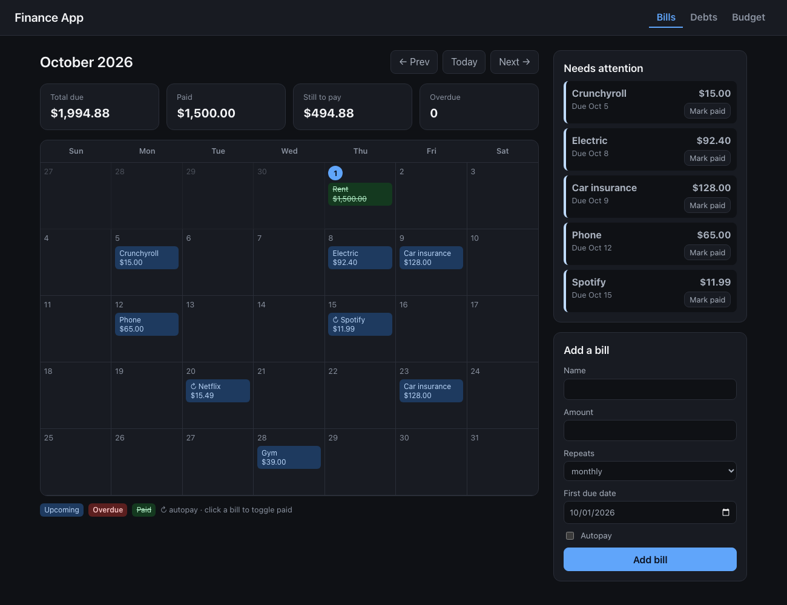
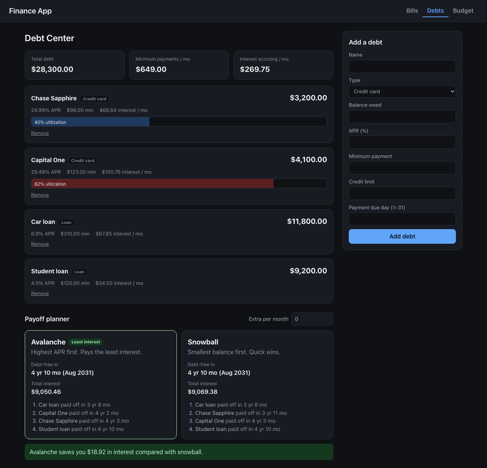
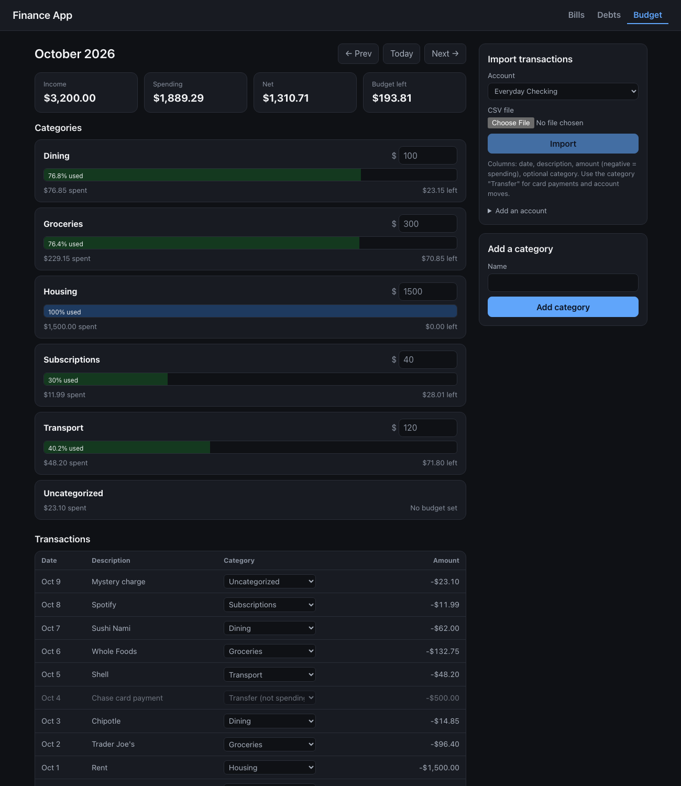

# Finance App

A free, self-hosted take on Rocket Money: track bills on a calendar, get out of debt with a payoff
planner, and see where your money goes. Built to be run on your own machine with your own data.

| Bills Calendar | Debt Center |
| --- | --- |
|  |  |



_Screenshots use demo data._

## Features

**Bills Calendar**
- Recurring bills (weekly, biweekly, monthly, yearly) laid out on a month grid.
- Each bill is marked upcoming, overdue or paid. Click a bill to toggle it paid.
- A "Needs attention" list for anything overdue or due in the next 14 days.
- Monthly bills clamp to the end of short months, so a bill due on the 31st lands on Feb 28.

**Debt Center**
- Credit cards and loans with balance, APR, minimum payment and monthly interest.
- Credit card utilization bars that change color at 30% and 70%.
- A payoff planner that simulates avalanche (highest APR first) and snowball (smallest balance
  first) month by month, with an "extra payment per month" input. It shows the debt-free date,
  total interest, and how much avalanche saves. It also flags plans that never pay off.

**Budget & Spending**
- Import bank CSVs (duplicate rows are skipped, bad rows are reported by line number).
- Monthly category budgets with progress bars and inline editing.
- Recategorize transactions, or mark them as transfers so card payments and account moves do not
  count as spending.

## Stack

| Layer | Tech |
| --- | --- |
| Frontend | React 19, TypeScript, Vite, TanStack Query, Vitest + Testing Library |
| Backend | Python, FastAPI, SQLAlchemy 2, Alembic, Pydantic |
| Database | PostgreSQL 16 |
| Tooling | uv, pytest, oxlint |

## Getting started

Requires Python (managed by [uv](https://docs.astral.sh/uv/)), Node 20+, and PostgreSQL.

```sh
# 1. Database (macOS example)
brew install postgresql@16 && brew services start postgresql@16
createdb finance && createdb finance_test

# 2. Backend
cd backend
cp .env.example .env            # set the username in DATABASE_URL
uv sync
uv run alembic upgrade head
uv run uvicorn app.main:app --reload   # http://localhost:8000/docs

# 3. Frontend (new terminal)
cd frontend
npm install
npm run dev                     # http://localhost:5173
```

### Tests

```sh
cd backend && uv run pytest     # runs against the finance_test database
cd frontend && npm test
```

### Importing transactions

Upload a CSV from the Budget tab with the columns `date, description, amount` and an optional
`category`. Amounts are negative for spending. Dates can be `YYYY-MM-DD` or `MM/DD/YYYY`. Use the
category `Transfer` for card payments and account moves.

## API

Interactive docs are served at `/docs`. The main routes:

| Route | Purpose |
| --- | --- |
| `GET /bills/calendar?month=YYYY-MM` | Bill occurrences for a month with paid/overdue/upcoming status |
| `POST /bills/{id}/payments` | Mark a bill paid for a due date |
| `GET /debts/summary` | Total debt, interest, and per-debt utilization |
| `GET /debts/payoff?extra=100` | Avalanche vs. snowball simulation |
| `POST /transactions/import?account_id=` | CSV import |
| `GET /budgets/summary?month=YYYY-MM` | Limit, spent and remaining per category |
| `GET /spending/summary?month=YYYY-MM` | Income, spending and net for a month |

## Design notes

- **Money is `Decimal` end to end.** Amounts are `NUMERIC(12,2)` in Postgres and serialized as
  strings in the API, so there is no floating-point drift.
- **The payoff simulator keeps the monthly budget constant.** When a debt is paid off, its minimum
  payment rolls into the next target, and a debt whose minimum is below its monthly interest is
  reported as never paid off instead of looping forever.
- **Transfers are explicit.** Without a flag, paying a credit card from checking would count as
  spending twice. Transfers are excluded from every spending and budget total.
- **Schema changes go through Alembic migrations.** Tests run against a real Postgres database.

## Status and roadmap

Done: bills calendar, debt center, budgets and spending, CSV import.

Planned: LLM-assisted transaction categorization, a chat assistant that answers questions about
your own data with tool calling, authentication, and a hosted demo.
